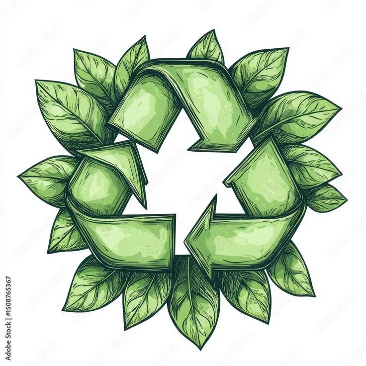
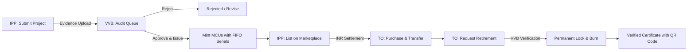
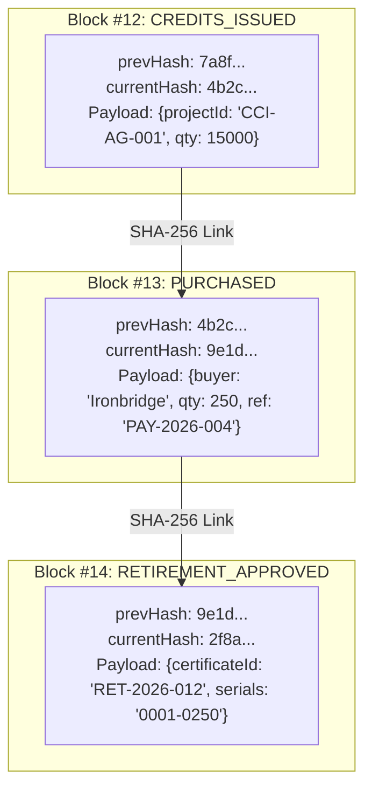

<div align="center">

  

  # CarbonChain

  **Enterprise-Grade, SHA-256 Hash-Chained Carbon Credit Lifecycle & Trading Platform**

  *Bridging Voluntary Carbon Markets with Immutable Cryptographic Integrity and Carbon Registry India (CRI) Standards.*

  <br />

  [](https://carbonchain-eosin.vercel.app)
  [](https://vitejs.dev/)
  [](https://react.dev/)
  [](https://tailwindcss.com/)
  [](https://carbonchain-eosin.vercel.app/verifier/ledger)
  [](LICENSE)

  <br />

  [**🚀 Explore Live Demo**](https://carbonchain-eosin.vercel.app) &nbsp;&bull;&nbsp;
  [**📖 Architecture & Ledger**](#-architecture--cryptographic-ledger) &nbsp;&bull;&nbsp;
  [**⚡ Quickstart**](#-getting-started) &nbsp;&bull;&nbsp;
  [**🛡️ Access Matrix**](#-strict-role-based-access-control-rbac) &nbsp;&bull;&nbsp;
  [**🧪 3-Minute Walkthrough**](#-interactive-3-minute-demo-walkthrough)

</div>

---

## 📌 Executive Summary

Traditional voluntary carbon markets face critical structural challenges: **opaque paper audit trails, phantom credits, double counting, and fragmented registries**. 

**CarbonChain** resolves these systemic vulnerabilities by digitizing the end-to-end carbon credit lifecycle into an immutable, verifiable, and cryptographic workflow. Modeled directly upon the **Carbon Registry India (CRI)** regulatory methodology, CarbonChain guarantees that:
- Every credit batch represents genuine, audited emissions reductions (1 MCU = 1 tCO2e).
- Each issued credit receives a discrete FIFO serial number (`CCI-PRJ-000001`).
- Retirement is strictly verifier-gated, permanently locked, and mathematically tamper-evident.
- Complete provenance from project onboarding to permanent burn is publicly auditable in real time.

---

## 🏛️ CRI Regulatory Taxonomy Mapping

CarbonChain maps directly to official institutional carbon market roles:

| CRI Market Entity | CarbonChain Platform Actor | Primary Role & Permissions |
|:---|:---|:---|
| **IPP** *(Independent Project Proponent)* | **Project Owner / Seller** | Registers emission reduction projects, uploads verifiable documentation, sets pricing, and manages inventory. |
| **VVB** *(Validation & Verification Body)* | **Verification Authority (Auditor)** | Conducts methodological audits, approves/rejects submissions, issues MCUs, and ratifies retirement requests. |
| **TO** *(Transactional Organisation)* | **Buyer / Obligated Entity** | Procures verified credits, monitors Scope 1/2/3 impact metrics, and requests certificate retirements. |
| **MCU** *(Marketable Carbon Unit)* | **Tokenized Carbon Credit** | Certified unit representing **1 metric tonne of CO2 equivalent** (1 MCU = 1 tCO2e). |

---

## 🌟 Core Innovations & Key Features

### 1. 🛡️ SHA-256 Hash-Chained Tamper-Evident Ledger
Every significant event—submission, evidence fingerprinting, audit issuance, listing, trade execution, retirement request, and verifier approval—is encapsulated into an indexed block linked via `prevHash` and `currentHash` using SHA-256. If a single byte of ledger history is altered, the chain breaks visibly, triggering immediate audit warnings.

### 2. 🔒 Zero Double-Counting Guarantee
Once an obligated entity requests retirement and the VVB approves it:
- The specific credit serials are moved to **Retired** status and permanently locked.
- The smart contract / ledger logic prohibits re-listing, transfer, or re-issuance.
- A public, tamper-resistant **Retirement Certificate** is generated with a cryptographic QR code linking directly to the permanent burn record.

### 3. 🧪 Cryptographic Evidence Fingerprinting
Project proponents upload project design documents, satellite imagery, and baseline calculation sheets. CarbonChain computes and immutably records SHA-256 hashes of all project artifacts onto the ledger at submission time, preventing retroactive evidence manipulation.

### 4. 📊 Scientific Impact Engine & SDG Alignment
Built-in heuristic modeling calculates real-world environmental equivalents for every purchase:
- **Tree Absorption Equivalent:** $\approx 45\text{ mature trees preserved/year per tonne}$ (IPCC FAR 1990 standard).
- **Passenger Vehicle Offset:** $\approx 2,400\text{ km of passenger vehicle emissions averted per tonne}$.
- **UN Sustainable Development Goals (SDGs):** Automated tagging and compliance tracking for SDG 13 (*Climate Action*), SDG 15 (*Life on Land*), SDG 7 (*Affordable Clean Energy*), and SDG 8 (*Decent Work*).

---

## 🏗️ Architecture & State Machine

### Credit Lifecycle State Transition



### Hash-Chained Block Topology



---

## 🛡️ Strict Role-Based Access Control (RBAC)

CarbonChain enforces separation of concerns at both the UI layer and the service state machine:

| Platform Capability | IPP (Seller) | TO (Buyer) | VVB (Verifier) | Public Guest |
|:---|:---:|:---:|:---:|:---:|
| **Submit / Edit Own Projects** | ✅ | ❌ | ❌ | ❌ |
| **Manage Pricing & Active Listings** | ✅ | ❌ | ❌ | ❌ |
| **Audit, Approve & Reject Projects** | ❌ | ❌ | ✅ | ❌ |
| **Browse Public Marketplace** | ✅ | ✅ | ✅ | ✅ |
| **Purchase Verified MCUs** | ❌ | ✅ | ❌ | ❌ |
| **Initiate Retirement Request** | ❌ | ✅ | ❌ | ❌ |
| **Approve Retirement (Permanent Burn)** | ❌ | ❌ | ✅ | ❌ |
| **Direct Retirement without Audit** | 🚫 *Prohibited* | 🚫 *Prohibited* | 🚫 *Prohibited* | 🚫 *Prohibited* |
| **Inspect Public Ledger & QR Verification** | ✅ | ✅ | ✅ | ✅ |

---

## 👥 Seeded Evaluation Accounts

To facilitate instant testing and evaluation, CarbonChain includes pre-configured CRI organizational profiles with deterministic cryptographic wallets:

| Account Name | Designated Role | Capabilities | Credentials | Deterministic Wallet Address |
|:---|:---|:---|:---|:---|
| **Meridian Renewables Ltd** | Project Owner (IPP) | `SELL` | `meridian@carbonchain.in`<br/>`Password123` | `0xA3f1b8c4d5e6a7b8c9d0e1f2a3b4c5d6e7f8a9b0` |
| **Ironbridge Steel and Cement Ltd** | Obligated Buyer (TO) | `BUY` | `ironbridge@carbonchain.in`<br/>`Password123` | `0xB4c2d3e4f5a6b7c8d9e0f1a2b3c4d5e6f7a8b9c0` |
| **Diya Mali, Verification Authority** | Auditor (VVB) | `VERIFY` | `diya.mali@carbonchain.in`<br/>`Password123` | `0xC5d3e4f5a6b7c8d9e0f1a2b3c4d5e6f7a8b9c0d1` |

> *Tip: The Login page provides a **"Quick Sign In"** panel allowing instant one-click switching between these three stakeholder personas.*

---

## 🧪 Interactive 3-Minute Demo Walkthrough

Follow this sequence to test the entire lifecycle end-to-end:

### Phase 1: Submit Project as IPP (Seller)
1. Sign in as **Meridian Renewables Ltd**.
2. Navigate to **Submit Project** (`/submit`).
3. Click **"Fill it"** to auto-populate a compliant agroforestry project (location: *Jalgaon, Maharashtra*, estimated volume: *15,000 tCO2e*).
4. Click **Submit Project**. Notice the instant SHA-256 document hashing and ledger confirmation.

### Phase 2: Audit & Issue as VVB (Verifier)
1. Switch account to **Diya Mali, Verification Authority**.
2. Open **Review Queue** (`/verifier`).
3. Inspect project evidence, baseline methodologies, and environmental claims.
4. Click **Approve Project** &rarr; The ledger issues verified MCUs with assigned FIFO serials.

### Phase 3: Procure & Offset as TO (Buyer)
1. Switch account to **Ironbridge Steel and Cement Ltd**.
2. Browse the **Marketplace** (`/marketplace`) and select a verified project listing.
3. Choose quantity (e.g., `250 tCO2e`), review subtotal and platform fee, and execute purchase via the settlement sheet.
4. Open **My Credits** (`/my-credits`) to inspect owned holdings and allocated serial ranges.

### Phase 4: Request Retirement & Verifier Ratification
1. Under **My Credits**, click **Request Retirement** on the purchased batch.
2. Specify beneficial details (*e.g., Scope 1 Mandatory Compliance FY2025*).
3. Switch to **Diya Mali, Verification Authority** and open **Retirement Requests** (`/verifier/retirements`).
4. Click **Approve Retirement**. The units are permanently locked and burned.
5. The buyer receives a verifiable **Retirement Certificate** (`/certificate/:id`) with an active QR code that anyone can scan to verify authenticity.

---

## 💻 Tech Stack & System Specifications

```
Frontend Architecture       React 18 + Vite 6 + React Router v6
Styling & Design System     Tailwind CSS (Forest `#1F4D3A` & Cream `#F6F2E8` Palette)
Ledger & Cryptography       SHA-256 Block Chaining, Deterministic Address Derivation
Blockchain Integration      Ethers.js v6 (Polygon Amoy Testnet Chain ID 80002 compatibility)
Component Utilities         Lucide React, Framer Motion, qrcode.react
Deployment & Hosting        Vercel Edge Network (Global CDN, SPA Client Rewrites)
```

---

## ⚡ Getting Started

### Prerequisites
- **Node.js**: `v18.0.0` or later
- **npm**: `v9.0.0` or later

### Installation & Local Setup

1. **Clone the repository:**
   ```bash
   git clone https://github.com/DiyaMali/CarbonChain.git
   cd CarbonChain
   ```

2. **Install project dependencies:**
   ```bash
   npm install
   ```

3. **Configure environment variables (optional):**
   ```bash
   cp .env.example .env
   ```

4. **Launch development server:**
   ```bash
   npm run dev
   ```
   Open your browser at **`http://localhost:5173`**.

5. **Build for production:**
   ```bash
   npm run build
   ```

---

## 📁 Repository Directory Structure

```plaintext
CarbonChain/
├── public/                 # Static assets, branding, and images
│   ├── images/projects/    # Verified CRI project photography
│   └── logo.png            # Official CarbonChain emblem
├── src/
│   ├── components/         # Reusable design system components
│   │   ├── EcoIcon.jsx     # Curated botanical & environmental SVG iconography
│   │   ├── EnterpriseLayout.jsx # Role-adaptive shell navigation
│   │   ├── Navbar.jsx      # Navigation header with wallet indicator
│   │   └── PaymentSheet.jsx# Multi-method settlement drawer
│   ├── config/             # Immutable platform configuration
│   │   ├── accounts.js     # Seeded CRI institutional personas & wallets
│   │   ├── contract.js     # Smart contract addresses & ledger flags
│   │   └── factors.js      # Scientific emission factor coefficients
│   ├── data/
│   │   └── criProjects.js  # Seeded CRI methodology project dataset
│   ├── context/            # React context providers (Auth, Wallet, Toast)
│   ├── services/           # Core domain business logic
│   │   ├── ledgerService.js# SHA-256 hash-chaining engine & block state
│   │   ├── roleService.js  # RBAC enforcement logic
│   │   └── walletUtils.js  # Deterministic address derivation
│   ├── pages/              # Platform route views
│   │   ├── Landing.jsx     # Institutional landing page
│   │   ├── Marketplace.jsx # Transparent credit exchange
│   │   ├── VerifierDashboard.jsx # VVB audit control center
│   │   ├── Certificate.jsx # Verified print/PDF retirement deed
│   │   └── Impact.jsx      # Environmental analytics dashboard
│   ├── App.jsx             # Route definitions & guards
│   └── index.css           # Global typography and theme tokens
├── vercel.json             # Vercel SPA routing and rewrite rules
├── package.json            # Project manifest and dependencies
└── tailwind.config.js      # Design tokens and custom theme extension
```

---

## 🚀 Deployment & Production Hosting

CarbonChain is hosted on **Vercel** with full client-side SPA routing support via [`vercel.json`](./vercel.json):

```json
{
  "framework": "vite",
  "rewrites": [
    {
      "source": "/(.*)",
      "destination": "/index.html"
    }
  ]
}
```

- **Live Production URL:** [https://carbonchain-eosin.vercel.app](https://carbonchain-eosin.vercel.app)
- **Continuous Deployment:** Configured via GitHub Integration on branch `main`.

---

## ⚖️ License & Attribution

This project is open-sourced under the **MIT License**. See the [LICENSE](LICENSE) file for full details.

- **Lead Engineer & Project Owner:** [Diya Mali](https://github.com/DiyaMali)
- **Institution:** Dr. Babasaheb Ambedkar Technological University (DBATU), Maharashtra, India
- **Methodology Baseline:** Carbon Registry India (CRI) Framework

---

<div align="center">
  <sub>Built with precision for transparent, verifiable, and double-counting-free carbon markets.</sub>
</div>
